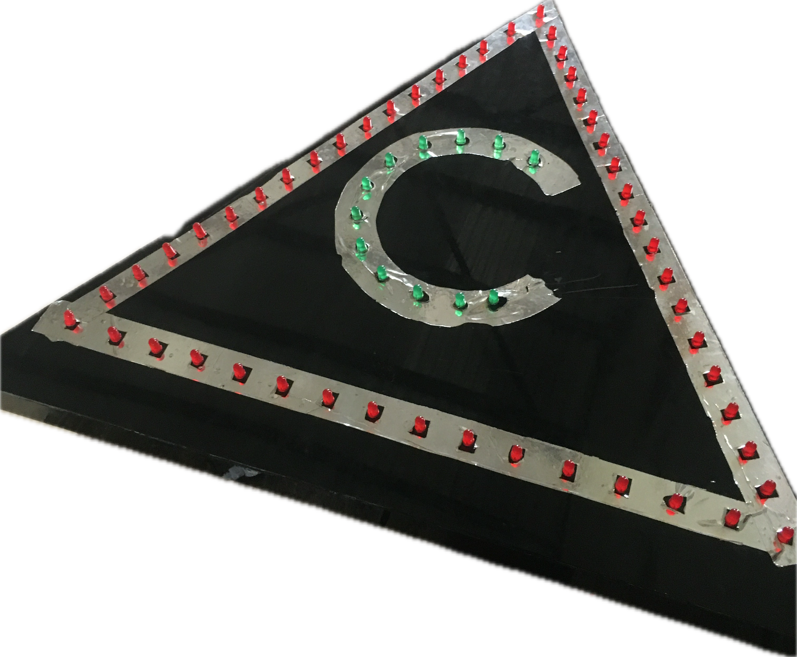

# C-Caution Sign (2021 project)

> **Status: repository upload of the C-Caution undergraduate project carried out in 2021.**
> It contains the project photograph, circuit details, firmware, automated tests, and instructions
> for recreating the circuit in Proteus.

A triangular safety sign ("C-Caution"). About 50 red LEDs run along the three edges and 12
green LEDs form the letter C in the centre. Intended sequence: the red LEDs chase around the triangle,
then the green C lights from top to bottom, then it repeats.



## How it works

| Block | Part | Job |
|---|---|---|
| Sequencer | Arduino Uno (ATmega328P) | Decides the stage, drives the 12 green LEDs, gates the red chase |
| Clock | NE555 astable (R1 4.7 kΩ, R2 10 kΩ, C1 10 µF) | About 5.8 Hz pulses; speed of the red chase |
| Counter | CD4017 | Q0..Q9 each switch one group of 5 red LEDs |
| Group drivers | 10 × logic-level N-MOSFET | Sink the current of 5 LEDs (the 4017 cannot) |
| Red supply switch | 1 × P-MOSFET, high side | Cuts power to all red LEDs between stages |

Stages: **red chase** (3 laps, about 5 s) → short gap → **green sweep** (12 steps × 250 ms) →
gap → repeat. If the 555 clock is missing or stuck, everything switches off (FAULT) and retries.

The logic lives in [`firmware/c_caution/sequencer.h`](firmware/c_caution/sequencer.h), which has
no Arduino dependency so it can be unit-tested on a PC. [`c_caution.ino`](firmware/c_caution/c_caution.ino)
only maps pins.

## Repository layout

```
README.md                 this file
CHANGES.md                repository design decisions and verification notes
parts.csv  wiring.csv     bill of materials and net list (generated)
block_diagram.svg         block diagram
firmware/c_caution/       sequencer.h (logic) + c_caution.ino (pins)
tests/test_sequencer.cpp  host tests with a behavioural 555 + 4017 model
tests/test_netlist.py     checker regression tests with deliberate wiring mutations
tools/generate_netlist.py writes parts.csv and wiring.csv
tools/check_netlist.py    static netlist checks
docs/                     DESIGN_NOTES and PROTEUS_STEPS
Makefile                  make test | make check | make all
```

## Run the checks

```
make test    # host tests (needs a C++11 compiler)
make check   # netlist checks (needs Python 3)
make all
```

To use the sketch: open `firmware/c_caution/c_caution.ino` in the Arduino IDE (keep
`sequencer.h` in the same folder) and check the pin constants against your wiring.

## Checks

Current automated results:

- 35 host-test checks pass against a behavioural 555/CD4017 model. Coverage includes 1- and
  5-lap runs, both green modes, a slower clock, fault counters, a sub-poll glitch, zero green
  step time, repeated cycles, and `millis()` rollover during a timed state.
- The static checker reports 0 errors and 0 warnings on the generated netlist. Its 18-check
  regression test catches eight deliberate wiring mutations, including the exact Arduino pin
  map, 555 topology, CD4017 output order, missing pull resistors, LED resistors, and MOSFET ground.
- The CI workflow includes an Arduino Uno compile job using Arduino CLI 1.5.1 and Arduino AVR
  core 1.8.8.
- Datasheet-dependent statements cite the official TI, Microchip, and onsemi documents linked in
  `docs/DESIGN_NOTES.md`; calculated currents and timing are identified as estimates.

## Project details

- The photograph shows the triangular sign, its red perimeter LEDs, and the green C.
- The circuit files use 50 red LEDs in ten groups and 12 green LEDs. The red groups are
  interleaved around the triangle.
- The host model covers the calculated 555 timing and the controller's counter-release logic.
- A clock glitch shorter than the Arduino polling interval can advance the CD4017 without being
  counted by the controller model, as demonstrated by the behavioural test.

## Contributing

Small, focused issues and pull requests are welcome; there is no separate contributing guide.

## License

MIT. See [`LICENSE`](LICENSE).
